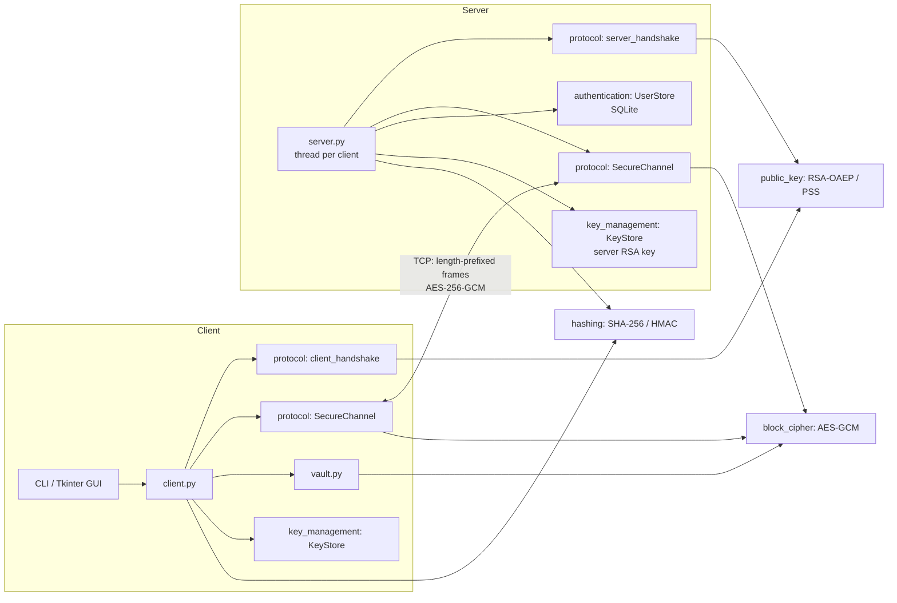
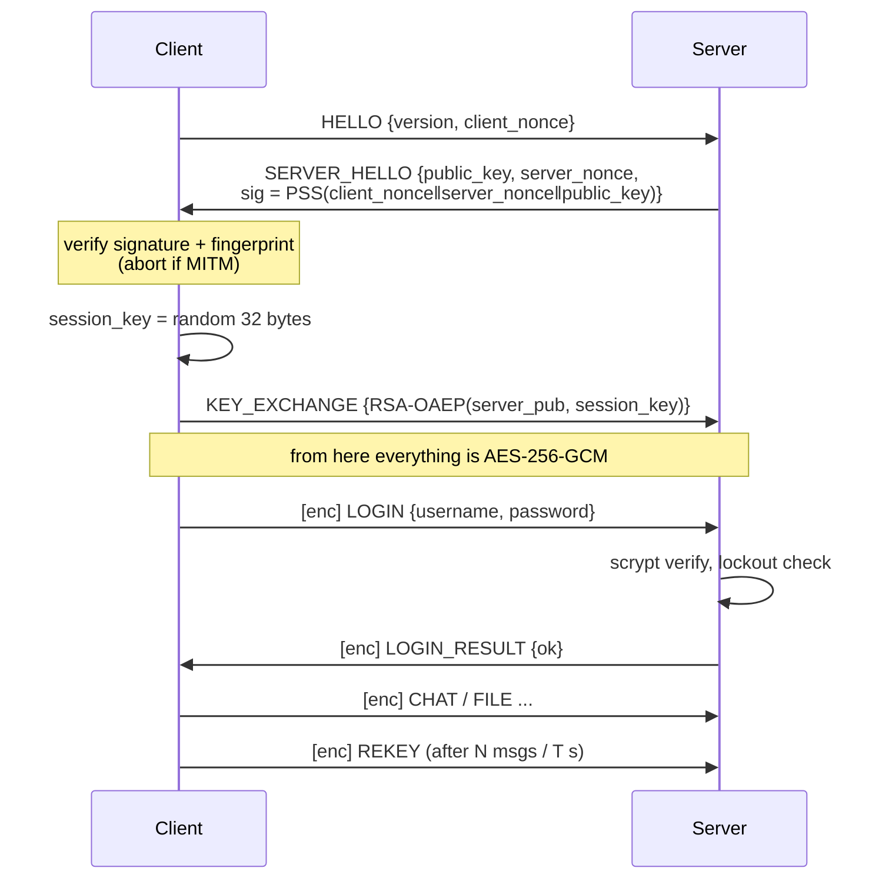

# Phase 1 — Software Requirements Specification & Design Document
**CSE461 Cryptography and Security — Secure Communication Suite**
Ain Shams University, Faculty of Engineering, CHEP Fall 2026
Team: _Member A, B, C, D, E (fill in names / IDs)_ · Version 0.1 · 25 Nov 2026

> Status: draft for the Phase 1 presentation. Sections marked _TODO_ need team input.

---

## 1. Introduction

### 1.1 Problem statement
Data sent over the Internet travels through networks the sender does not control, and
data stored on disk can be stolen. Without cryptography, an attacker can **read**
(eavesdrop), **modify** (tamper), **replay** or **impersonate**. This project builds a
Python application that protects communication between users against these threats,
both **in transit** and **at rest**, by combining standard cryptographic primitives into
a small secure protocol, in the same way TLS does for HTTPS.

### 1.2 Research objectives
1. **O1:** Provide confidentiality of messages and files using a standard block cipher (AES-256-GCM).
2. **O2:** Establish shared session keys securely using public-key cryptography (RSA-OAEP), without pre-shared secrets.
3. **O3:** Guarantee integrity and authenticity of data using SHA-256, HMAC and digital signatures (RSA-PSS).
4. **O4:** Manage the full key lifecycle: generation, distribution, protected storage, rotation and expiry.
5. **O5:** Authenticate users with salted, memory-hard password hashing (scrypt) and authenticate the server with signatures (mutual authentication).
6. **O6:** Integrate the modules into a working client–server Internet service and **evaluate** it experimentally (correctness, attack resistance, performance).

### 1.3 Scope
In scope: a TCP client/server secure chat and file-transfer service, CLI (plus optional
Tkinter GUI), encrypted local vault, test suite and benchmarks.
Out of scope: production deployment, group chat key agreement, mobile clients, and
implementing a full standards-compliant TLS stack.

### 1.4 Definitions
AES (Advanced Encryption Standard), GCM (Galois/Counter Mode), AEAD (Authenticated
Encryption with Associated Data), RSA-OAEP (Optimal Asymmetric Encryption Padding),
PSS (Probabilistic Signature Scheme), HMAC (keyed-hash message authentication code),
KDF (key derivation function), CSPRNG (cryptographically secure random number generator),
MITM (man-in-the-middle).

---

## 2. Overall description

### 2.1 Product perspective
A standalone Python 3.10+ application with two programs: `suite.server` and
`suite.client`. Cryptographic primitives come from the vetted **PyCryptodome** library
(the same library the specification's skeleton uses). The team writes the protocol, key
management, authentication logic and integration.

### 2.2 Users
| Actor | Description |
|---|---|
| End user | Registers, logs in, chats, sends files, manages own keys and vault |
| Server operator | Runs the server, owns the server RSA key, sees security logs |
| Attacker (threat actor) | Can observe, modify, drop, replay and inject network traffic; may steal the server database or a user's disk |

### 2.3 User stories with acceptance criteria
| ID | User story (from spec) | Acceptance criteria | Module |
|---|---|---|---|
| US1 | Encrypt my messages using a block cipher so they can be securely transmitted | Captured traffic (Wireshark) shows no plaintext; receiver decrypts correctly | block_cipher, protocol |
| US2 | Use public-key cryptosystems to securely share keys with my partner | Session key is only ever sent RSA-OAEP-wrapped; both sides derive the same key | public_key, protocol |
| US3 | Verify the integrity of received messages using hashing | Any modified message/file is rejected; file SHA-256 shown and verified on receipt | hashing, block_cipher |
| US4 | Manage my cryptographic keys securely | Private keys stored encrypted; user can generate, list, rotate keys; wrong passphrase rejected | key_management |
| US5 | Authenticate myself to the system to ensure secure access | Login required before any service; passwords stored as scrypt hashes; lockout after 5 failures | authentication |
| US6 | Secure my internet services using the provided modules | Chat and file transfer run only over the secure channel; replay and MITM attempts fail | protocol, server, client |

---

## 3. Requirements

### 3.1 Functional requirements
| ID | Requirement | Story |
|---|---|---|
| FR1 | The system shall encrypt every application message with AES-256-GCM using a unique nonce | US1 |
| FR2 | The system shall reject any message whose GCM tag fails to verify | US1, US3 |
| FR3 | The client shall generate a random 256-bit session key and send it encrypted with the server's RSA-3072 public key (OAEP-SHA256) | US2 |
| FR4 | The server shall sign the handshake with RSA-PSS; the client shall verify the signature and the server key fingerprint | US2, US6 |
| FR5 | The system shall compute and display SHA-256 checksums of transferred files and verify them on receipt | US3 |
| FR6 | The system shall provide HMAC-SHA256 for keyed integrity checks | US3 |
| FR7 | The system shall store private keys only in encrypted PKCS#8 form protected by a passphrase | US4 |
| FR8 | The system shall rotate the session key after N messages or T seconds | US4 |
| FR9 | The user shall be able to generate, list, export (public) and load keys | US4 |
| FR10 | The server shall store passwords only as salted scrypt hashes | US5 |
| FR11 | The server shall lock an account for 5 minutes after 5 consecutive failed logins | US5 |
| FR12 | Login credentials shall only be sent inside the encrypted channel | US5, US6 |
| FR13 | The system shall reject replayed or reordered messages using sequence numbers | US6 |
| FR14 | The system shall support encrypted chat and encrypted file transfer between users via the server | US6 |
| FR15 | The user shall be able to encrypt local files/chat history in a passphrase-protected vault | US4, US6 |

### 3.2 Non-functional requirements
| ID | Category | Requirement |
|---|---|---|
| NFR1 | Security | Minimum 128-bit security level for all primitives (NIST SP 800-57) |
| NFR2 | Security | No secrets (keys, passwords) written to logs or stored in plaintext |
| NFR3 | Security | All randomness from the OS CSPRNG |
| NFR4 | Performance | Chat message encryption + decryption < 5 ms; handshake < 1 s on a laptop |
| NFR5 | Reliability | One misbehaving client must not crash the server (thread per client) |
| NFR6 | Maintainability | All security parameters in `suite/config.py`; ≥ 1 unit test per public function |
| NFR7 | Usability | CLI/GUI shows the server fingerprint and clear error messages |
| NFR8 | Portability | Runs on Windows, Linux and macOS with Python ≥ 3.10 |

---

## 4. Threat model
| Threat | Example | Countermeasure |
|---|---|---|
| Eavesdropping | Attacker sniffs Wi-Fi | AES-256-GCM encryption (FR1) |
| Tampering | Attacker flips bits in a message | GCM tag, HMAC, SHA-256 (FR2, FR5, FR6) |
| Replay | Attacker re-sends "pay 100 EGP" | Sequence numbers in authenticated header (FR13) |
| MITM / server impersonation | Fake server sends its own public key | RSA-PSS signed handshake + pinned fingerprint (FR4) |
| Password guessing online | Script tries many passwords | Account lockout (FR11) |
| Database theft | Attacker steals `users.db` | scrypt salted hashes (FR10) |
| Key theft from disk | Laptop stolen | Encrypted private keys and vault (FR7, FR15) |
| Long-term key misuse | Same session key used for days | Session key rotation (FR8) |

Known limitation to discuss in the report: RSA key transport gives **no forward secrecy**.
If the server's private key is later stolen, recorded sessions can be decrypted. An
(EC)DHE handshake would fix this (future work).

---

## 5. Architecture



Layering rule: `client`/`server` → `protocol` → primitive modules
(`block_cipher`, `public_key`, `hashing`) and services (`key_management`,
`authentication`, `vault`). Primitive modules never import higher layers.

Concurrency: the server accepts connections in the main thread and starts one thread per
client. The spec's queue-based `EncryptionWorker` is kept (fixed) for bulk file
encryption, so a large file transfer doesn't block the chat.

---

## 6. Module design (Phase 1, Q3: main functions of each module)

| Module | Owner | Main functions | Algorithm / standard |
|---|---|---|---|
| `block_cipher` | A | `generate_key`, `encrypt`, `decrypt`, `EncryptedPacket`, `EncryptionWorker` | AES-256-GCM (FIPS 197, SP 800-38D) |
| `public_key` | B | `generate_keypair`, `encrypt_session_key`, `decrypt_session_key`, `sign`, `verify`, `fingerprint`, PEM import/export | RSA-3072, OAEP-SHA256, PSS-SHA256 (RFC 8017) |
| `hashing` | C | `sha256`, `sha256_hex`, `sha256_file`, `hmac_sha256`, `verify_hmac`, `md5_hex` (comparison only) | SHA-256 (FIPS 180-4), HMAC (RFC 2104) |
| `key_management` | D | `generate_session_key`, `KeyStore` (save/load private & public keys, list), `SessionKeyPolicy` (rotation) | PKCS#8 + scrypt/AES-256 |
| `authentication` | D | `hash_password`, `verify_password`, `UserStore.register`, `UserStore.login` (lockout) | scrypt (RFC 7914) |
| `vault` | C | `derive_key`, `encrypt_bytes/decrypt_bytes`, `encrypt_file/decrypt_file` | scrypt + AES-256-GCM |
| `protocol` | E | `send_frame/recv_frame`, `client_handshake`, `server_handshake`, `SecureChannel.seal/open/send/recv` | custom, TLS-inspired |
| `server` / `client` | E | accept loop, per-client handler, CLI | TCP sockets, threading |

Shared: `config.py` (all parameters), `errors.py` (`IntegrityError`, `ReplayError`,
`AuthenticationError`, `AccountLockedError`, `KeyManagementError`, `ProtocolError`).

---

## 7. Protocol design

### 7.1 Handshake and login



### 7.2 Wire format
```
frame        = length (4 bytes, big-endian) || body
plain body   = UTF-8 JSON (handshake messages only)
secure body  = header_len (2) || header || nonce (12) || tag (16) || ciphertext
header       = JSON {"type": "...", "seq": n}   ← authenticated as GCM associated data
ciphertext   = AES-GCM(session_key, JSON payload)
```
The receiver rejects a frame if the tag fails (`IntegrityError`) or `seq` ≤ last seen
`seq` (`ReplayError`). Maximum frame size is 16 MiB; larger files are sent in chunks with
a final SHA-256 of the whole file.

---

## 8. Data storage design
| Store | Location | Content | Protection |
|---|---|---|---|
| User DB | `data/users.db` (SQLite) | `users(username PK, password_hash, failed_attempts, locked_until)` | scrypt hashes; no plaintext passwords |
| Keystore | `data/keystore/` | `<name>.priv.pem`, `<name>.pub.pem` | private keys encrypted (PKCS#8, scrypt + AES-256) |
| Vault | `data/vault/` | `SCSV1 ‖ salt ‖ nonce ‖ tag ‖ ciphertext` | scrypt-derived AES-256-GCM key |

`data/` is git-ignored, so keys and hashes are never committed.

---

## 9. Cryptographic choices and justification (Phase 1, Q2)
| Need | Chosen | Rejected and why |
|---|---|---|
| Symmetric cipher | **AES-256** | DES: 56-bit key, brute-forced in < 1 day (EFF DES Cracker, 1998); 3DES deprecated by NIST (2023) |
| Mode | **GCM** (AEAD) | ECB leaks patterns (the "ECB penguin"); CBC needs a separate MAC and is prone to padding-oracle attacks |
| Public key | **RSA-3072** | ECC (P-256/X25519) is faster with smaller keys and is discussed as an alternative; RSA chosen for clarity and course alignment |
| RSA padding | **OAEP / PSS** | Textbook RSA is deterministic and malleable; PKCS#1 v1.5 encryption is vulnerable to Bleichenbacher's attack |
| Hash | **SHA-256** | MD5: practical collisions (Wang et al. 2004; rogue CA certificate 2008); SHA-1: SHAttered collision (2017) |
| Password storage | **scrypt** | Plain/salted SHA-256 is too fast for GPU brute force; bcrypt and Argon2 are discussed as alternatives |
| Randomness | **OS CSPRNG** | Python `random` (Mersenne Twister) is predictable |

---

## 10. Answers to the Phase 1 questions
1. **What are the key components?** Six modules from the spec (block cipher, public key,
   hashing, key management, authentication, Internet-services security), implemented as
   `block_cipher`, `public_key`, `hashing`, `key_management`, `authentication` and
   `protocol` + `server`/`client`, plus `vault` for data at rest (sections 5–6).
2. **Which cryptographic techniques?** AES-256-GCM, RSA-3072 with OAEP and PSS, SHA-256,
   HMAC-SHA256 and scrypt, combined in a TLS-like handshake with sequence numbers and
   key rotation (section 9).
3. **Main functions of each module?** See the table in section 6.

---

## 11. Project plan

### 11.1 Timeline (deadline Friday 18 Dec 2026)
| Dates | Phase | Deliverables |
|---|---|---|
| 25 – 29 Nov | 1. Design & planning | This document, repo, Phase 1 slides |
| 30 Nov – 5 Dec | 2. Crypto modules | `block_cipher` ✅, `public_key`, `hashing` + tests; Phase 2 slides |
| 6 – 10 Dec | 3. Key management & auth | `key_management`, `authentication`, `vault` + tests; Phase 3 slides |
| 11 – 15 Dec | 4. Integration & testing | `protocol`, `server`, `client`, GUI, security tests, benchmarks; Phase 4 slides |
| 15 – 17 Dec | Report | Final report (.docx + .pdf), code zip, demo rehearsal |
| 18 Dec | Submission | One member submits |

_TODO: align phase ends with the course's presentation dates._

### 11.2 Roles
| Member | Primary | Report section |
|---|---|---|
| A _(name)_ | block_cipher, EncryptionWorker | Literature: symmetric ciphers & modes |
| B _(name)_ | public_key, handshake | Literature: RSA vs ECC, PKI |
| C _(name)_ | hashing, vault | Literature: hash functions, MD5/SHA-1 attacks |
| D _(name)_ | key_management, authentication | Literature: password hashing, key lifecycle |
| E _(name)_ | protocol, server/client, GUI, test lead | Methodology, results, report editor |

Every member must be able to explain every module, because "Answering Questions" is
30% of the presentation grade.

### 11.3 Process
Git with feature branches and pull requests; every PR is reviewed by another member
(see `CONTRIBUTING.md`). Twice-weekly meetings, with notes in `docs/meetings/`. Each phase
ends with a presentation and live demo.

### 11.4 Test strategy (detailed in Phase 4)
* **Unit tests** with official test vectors (FIPS 197, FIPS 180-4, RFC 4231).
* **Security tests:** tampering, wrong key, replay, MITM (fake server key), wrong password, lockout, wrong vault passphrase.
* **Integration tests:** real client/server over localhost.
* **Traffic evidence:** Wireshark capture showing only ciphertext.
* **Benchmarks:** AES by key size, RSA by key size, SHA-256 vs MD5, scrypt cost (`benchmarks/`).

---

## 12. Risks
| Risk | Likelihood | Impact | Mitigation |
|---|---|---|---|
| Unclear whether algorithms must be implemented from scratch | Medium | High | Ask the instructor in week 1; optional from-scratch "educational" versions checked against the library |
| Integration slips to the last days | High | High | Interfaces and tests fixed now; integrate continuously from Phase 3 |
| Member unavailable | Medium | Medium | Every module has a reviewer who knows it |
| Report written last-minute | High | High | Each owner writes their literature + methodology section alongside their code |

## 13. References (starter list)
* NIST FIPS 197 — AES; NIST SP 800-38D — GCM; NIST SP 800-57 — Key management
* NIST FIPS 180-4 — SHA-2; RFC 2104 / RFC 4231 — HMAC and test vectors
* RFC 8017 — PKCS #1 v2.2 (RSA-OAEP, RSA-PSS); RFC 7914 — scrypt
* RFC 8446 — TLS 1.3 (design inspiration)
* Stallings, *Cryptography and Network Security*; Katz & Lindell, *Introduction to Modern Cryptography*
